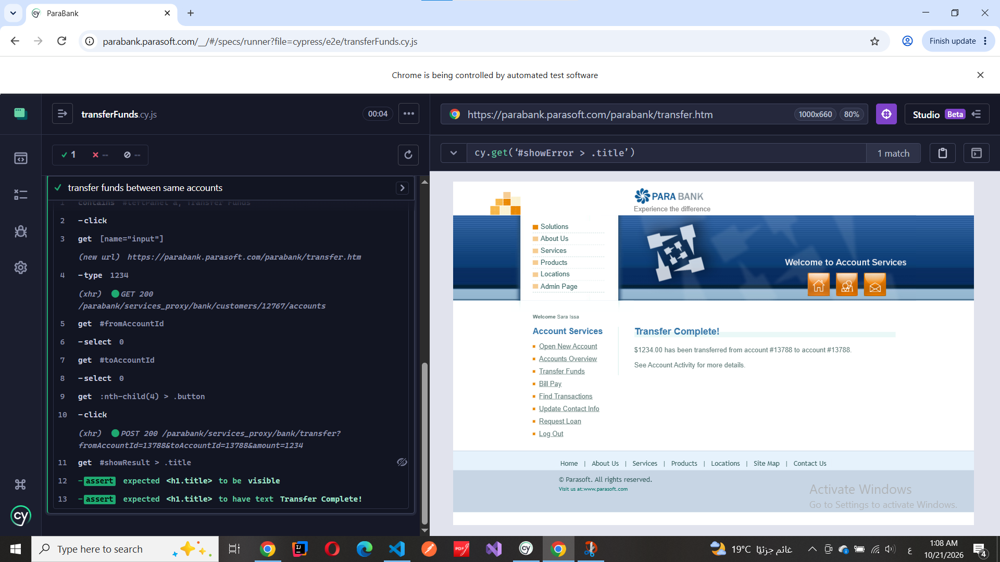
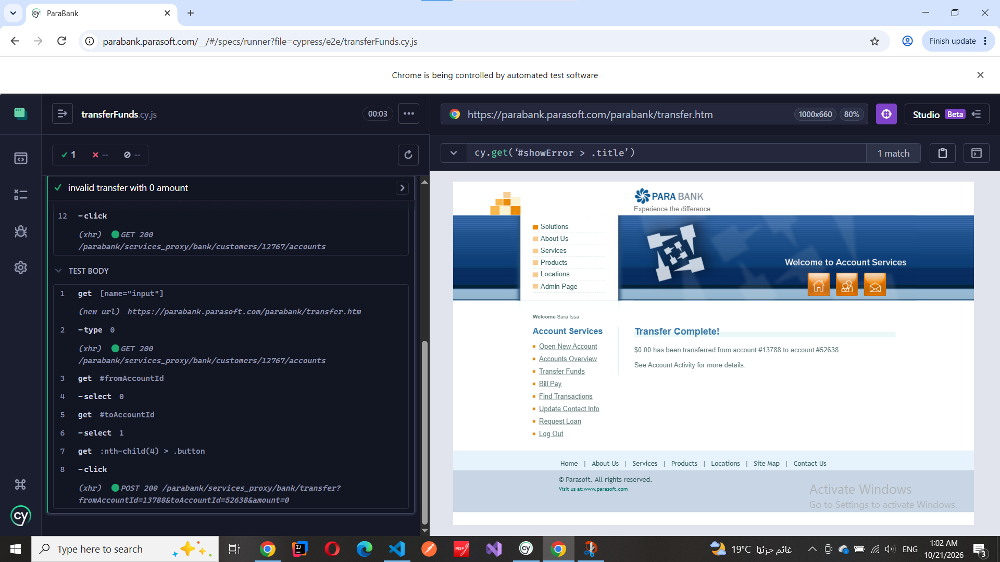
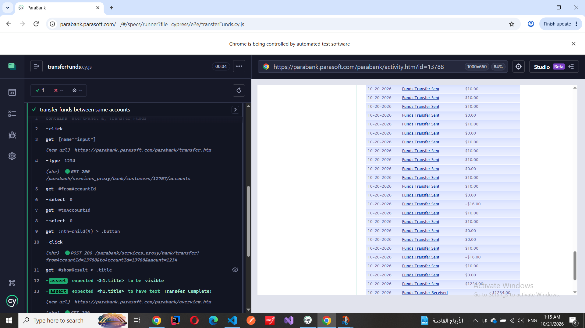

## BUG-001: Transfer to the same account is accepted

Status: Needs requirements confirmation

### Preconditions
User is logged in and has an account.

### Steps to reproduce
1. Open Transfer Funds.
2. Enter 1234 as the amount.
3. Select account 13788 as both source and destination.
4. Click Transfer.

### Actual result
The application displays:
"$1234.00 has been transferred from account #13788 to account #13788."

### Expected result
The application should reject transfers to the same account
and display a clear validation message.
This expectation needs confirmation against requirements.

### Evidence

## BUG-002: Transfer with 0 amount is accepted

Status: Needs requirements confirmation

### Preconditions
User is logged in and has an account.

### Steps to reproduce
1. Open Transfer Funds.
2. Enter 0 as the amount.
3. Select account 13788 as source and 52638 destination.
4. Click Transfer.

### Actual result
The application displays:
"$0.00 has been transferred from account #13788 to account #52638."

### Expected result
The application should reject transfers with 0 amount
and display a clear validation message.
This expectation needs confirmation against requirements.

### Evidence

### Note
Zero-amount transfers were recorded in Account Activity.

## BUG-003: Transfer with negative amount is accepted

Status: Needs requirements confirmation

### Preconditions
User is logged in and has an account.

### Steps to reproduce
1. Open Transfer Funds.
2. Enter -16 as the amount.
3. Select account 13788 as source and 52638 destination.
4. Click Transfer.

### Actual result
The application displays:
"-$16.00 has been transferred from account #13788 to account #52638."

### Expected result
The application should reject negative transfer amounts and display a clear validation message.

### Evidence

### Notes
Negative-amount transfers were recorded in Account Activity.
No balance change was observed in the before/after check.